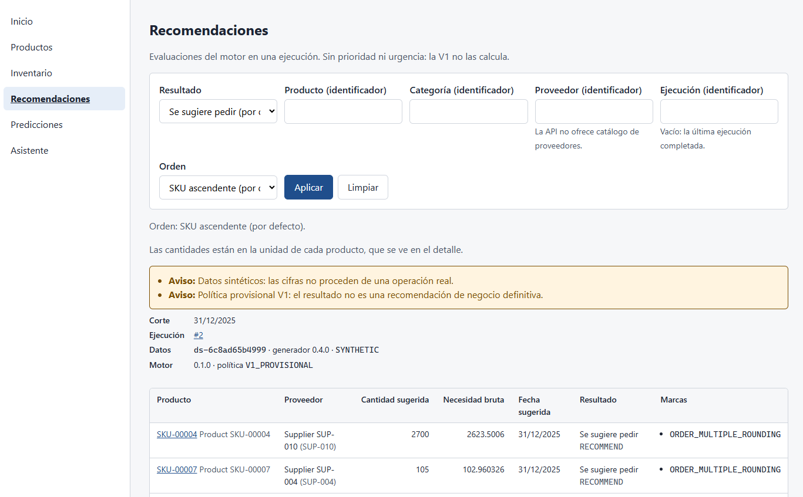
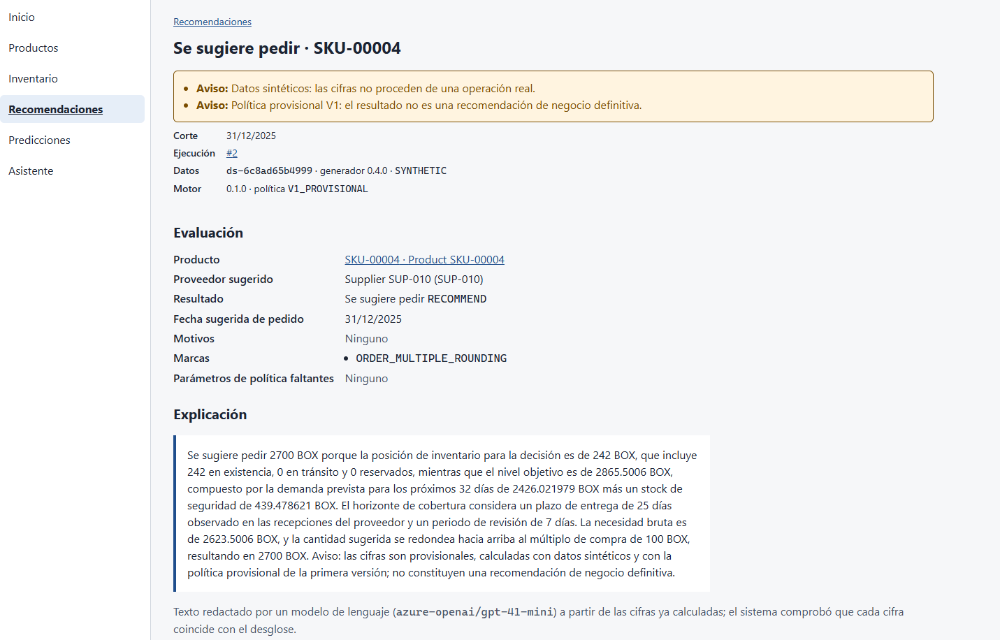
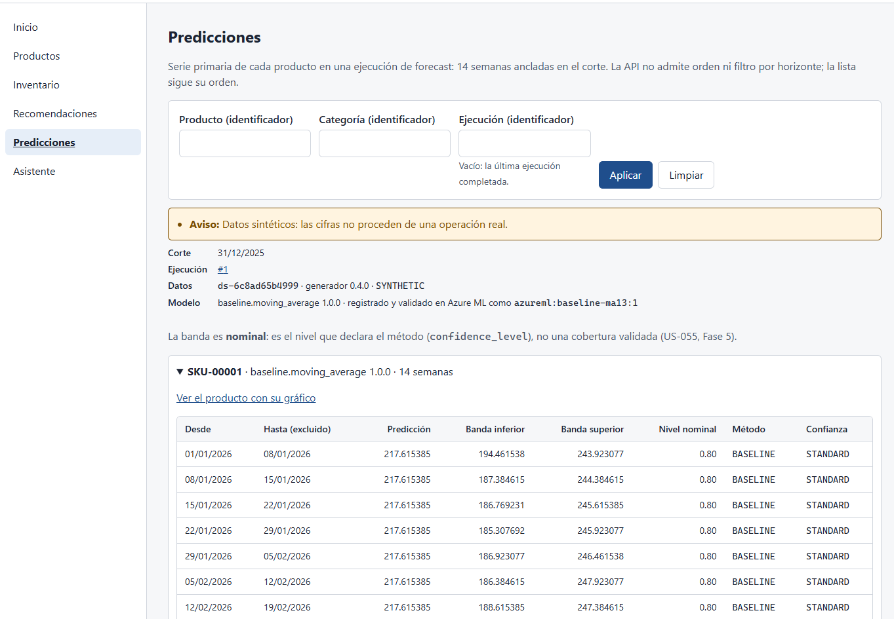
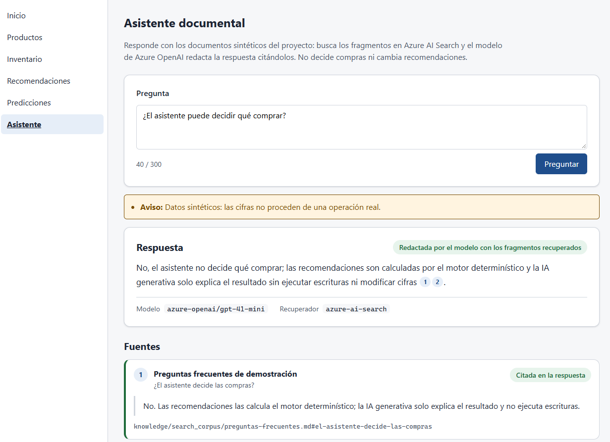
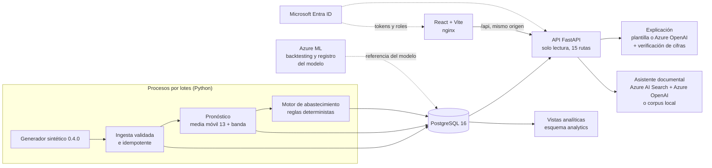

# Motor Predictivo de Abastecimiento de Inventarios

[](https://github.com/daniel02vazquez97-alt/G19X-ITH-DVT-209-ACADEMIC/actions/workflows/ci.yml)

Sistema de apoyo a la decisión de compras. A partir del histórico de consumo, el inventario, los plazos de entrega y
el comportamiento de los proveedores, **pronostica la demanda** de cada producto y **recomienda qué comprar, cuánto y
cuándo**. Cada recomendación es determinista, se explica cifra a cifra y se puede reconstruir meses después.

> **Estado (2026-10-20), con su comprobación:**
>
> - **MVP local, sin Azure:** `docker compose -f infra/docker-compose.yml --profile app up --build -d` y después
>   `python infra/docker/smoke.py`, que debe terminar en `SMOKE OK` (frontend → API → PostgreSQL, recomendaciones,
>   pronósticos, explicación y asistente con el corpus local). Probado el 2026-10-20 en un clon limpio: `SMOKE OK`,
>   9/9 comprobaciones.
> - **Azure `dev`:** `deploy-u12.ps1 -Stage Verify` 20/20 (2026-10-20) y `deploy-u15.ps1 -Stage Verify` en verde
>   (2026-10-18), con Microsoft Entra ID.
> - **Pruebas:** CI en verde en `main` ([`ci.yml`](.github/workflows/ci.yml)); en local, `python scripts/test.py`.
> - **Extras fuera del MVP:** explicaciones con Azure OpenAI, *backtesting* reproducido en Azure ML y **asistente
>   documental** con Azure AI Search ([Qué hace la aplicación](#qué-hace-la-aplicación)).
>
> Datos 100 % sintéticos (generador propio 0.4.0). Detalle en [Estado de implementación](#estado-de-implementación).

## Contenido

- [Qué problema resuelve](#qué-problema-resuelve)
- [Cómo evaluar el proyecto](#cómo-evaluar-el-proyecto)
- [Demo en 3 minutos (local, sin Azure)](#demo-en-3-minutos-local-sin-azure)
- [Capturas](#capturas)
- [Qué hace la aplicación](#qué-hace-la-aplicación)
- [Arquitectura](#arquitectura)
- [Estado de implementación](#estado-de-implementación)
- [Pruebas y calidad](#pruebas-y-calidad)
- [Despliegue en Azure](#despliegue-en-azure)
- [Estructura del repositorio](#estructura-del-repositorio)
- [Documentación](#documentación)
- [Limitaciones conocidas](#limitaciones-conocidas)
- [Licencia](#licencia)

## Qué problema resuelve

Las compras de reposición suelen decidirse por intuición. El resultado es desabasto (venta perdida, compras urgentes)
o sobreinventario (capital inmovilizado, obsolescencia). El sistema sustituye la intuición por evidencia cuantitativa
auditable **sin quitarle la decisión a la persona que compra**:

1. **Pronóstico** semanal por SKU con banda de incertidumbre (baseline oficial: media móvil de 13 semanas, evaluada
   por *backtesting* frente a otros métodos en el módulo `ml/`).
2. **Motor de abastecimiento** con reglas deterministas: stock de seguridad, nivel objetivo, posición de inventario,
   tránsito efectivo, pedido mínimo y múltiplo de compra. Aritmética exacta (fracciones y `Decimal`, sin `float`).
3. **Explicación** en lenguaje natural de cada recomendación, con verificación automática de que toda cifra del texto
   sale del cálculo. La IA generativa **redacta, nunca calcula**.

## Cómo evaluar el proyecto

1. **Arrancar la demo local** y pasar el *smoke test* ([siguiente sección](#demo-en-3-minutos-local-sin-azure)). No
   hace falta Azure ni ninguna credencial.
2. **Recorrer la interfaz** en <http://127.0.0.1:8080> con el token de `PLANNER`: Recomendaciones → abrir una
   recomendación (desglose del cálculo y explicación verificada) → Predicciones (gráfica con banda) → Asistente.
3. **Ver cómo se calcula una recomendación:** reglas en [`docs/06-motor-abastecimiento.md`](docs/06-motor-abastecimiento.md);
   código en `backend/app/supply_engine/engine.py` (cálculo puro) y `backend/app/runs/recommendation.py` (lee los datos,
   ejecuta el motor y persiste el resultado).
4. **Ver cómo la IA no inventa cifras:** `backend/app/genai/` (verificación de cifras de la explicación) y
   `backend/app/genai/assistant.py` (el asistente solo usa fragmentos de documentos, citados con `[n]`).
5. **Ejecutar las pruebas:** `python scripts/test.py` ([Pruebas y calidad](#pruebas-y-calidad)).
6. **Comprobar Azure** (opcional; exige una cuenta del tenant): evidencias en
   [`docs/reports/u12-cierre-evidencias.md`](docs/reports/u12-cierre-evidencias.md) y [`project/status.md`](project/status.md).

## Demo en 3 minutos (local, sin Azure)

**Requisitos:** Docker con Compose v2 para el sistema y Python 3 (solo la biblioteca estándar) para el *smoke test*. No
hacen falta Node, dependencias de Python ni credenciales.

**Probado el 2026-10-20** en un clon limpio de la rama, en Windows con Docker Desktop 29.8.1 (WSL 2, 12 CPU y 11,5 GiB
para Docker): la API respondió sana a los **1,9 min** del `up` y `smoke.py` terminó en `SMOKE OK` (9/9). Ese tiempo
aprovechó la caché de construcciones anteriores de Docker; la primera construcción en una máquina nueva tarda más,
porque descarga las imágenes base y construye las tres imágenes.

```bash
git clone https://github.com/daniel02vazquez97-alt/G19X-ITH-DVT-209-ACADEMIC.git
cd G19X-ITH-DVT-209-ACADEMIC
docker compose -f infra/docker-compose.yml --profile app up --build -d
```

El arranque genera el dataset sintético, crea la base, carga los datos, calcula el pronóstico y las 100
recomendaciones (corte 2025-12-31). Después:

| Qué | Dónde |
|---|---|
| Interfaz web | <http://127.0.0.1:8080> |
| API y su documentación OpenAPI | <http://127.0.0.1:8000/docs> |
| Comprobación automática de punta a punta | `python infra/docker/smoke.py` |
| Parar (y borrar datos con `-v`) | `docker compose -f infra/docker-compose.yml --profile app down` |
| Ver el estado si algo falla | `docker compose -f infra/docker-compose.yml --profile app ps -a` y `... logs --tail 40` |

En PowerShell, ejecuta `docker compose ... up` directamente: si su salida se canaliza (por ejemplo, dentro de
`Measure-Command { ... | Out-Default }`), Compose no obtiene la consola y se detiene con «failed to get console».

Sin Azure, el asistente documental responde con el corpus sintético incluido en la imagen de la API y muestra solo los
fragmentos con sus fuentes (estado `RETRIEVAL_ONLY`, sin modelo de lenguaje); el *smoke test* lo comprueba. Las
explicaciones usan la plantilla determinista. Se publican solo en `127.0.0.1` los puertos 8080 (interfaz), 8000 (API) y
5432 (PostgreSQL).

Para entrar en la interfaz se pega un token ficticio de [`.env.example`](.env.example), uno por rol:

| Rol | Token | Puede ver |
|---|---|---|
| `VIEWER` | `dev-example-viewer-0000000000` | Catálogo, inventario, pronósticos y recomendaciones |
| `ANALYST` | `dev-example-analyst-000000000` | Lo anterior y el histórico de consumo |
| `PLANNER` | `dev-example-planner-000000000` | Todo, incluidas las ejecuciones de cálculo |
| `ADMIN` | `dev-example-admin-00000000000` | Todo |

Los tokens solo se aceptan con `APP_ENV=local`; con `APP_ENV=dev` la API exige Microsoft Entra ID.

## Capturas

Entorno `dev` en Azure, con sesión de Microsoft Entra ID y datos sintéticos.

| Recomendaciones | Detalle con explicación |
|---|---|
|  |  |

| Predicciones | Asistente documental |
|---|---|
|  |  |

## Qué hace la aplicación

API REST de solo lectura (15 rutas, FastAPI) e interfaz React:

| Función | Ruta de la API | Vista |
|---|---|---|
| Catálogo con filtros y paginación | `GET /api/v1/products` | Productos |
| Detalle de producto, histórico de consumo | `GET /api/v1/products/{id}`, `/history` | Detalle |
| Pronóstico semanal con banda de incertidumbre | `GET /api/v1/products/{id}/forecast`, `/api/v1/forecasts` | Pronóstico (gráfica) |
| Inventario por producto | `GET /api/v1/inventory`, `/{id}` | Inventario |
| Recomendación con desglose del cálculo | `GET /api/v1/recommendations`, `/{id}`, `/products/{id}/recommendation` | Recomendaciones |
| Explicación verificada de la recomendación | `GET /api/v1/recommendations/{id}/explanation` | Recomendación |
| Ejecución de cálculo y su procedencia | `GET /api/v1/runs/{id}` | Ejecuciones |
| Identidad y roles; comprobación de la matriz de acceso | `GET /api/v1/me` | Comprobación de acceso |
| *Extra fuera del MVP:* asistente documental sobre el corpus sintético, con citas (`DT-103`) | `GET /api/v1/assistant/answer?q=` | Asistente |

Resultado sobre el dataset 0.4.0: 100 productos evaluados → 50 `RECOMMEND`, 40 `NO_NEED` y 10 `NOT_CALCULABLE`
(cada uno con su motivo). Cada respuesta lleva su **procedencia**: dataset, carga, ejecución, versión del motor y
avisos de datos sintéticos y política provisional.

## Arquitectura



| Capa | Responsabilidad | Frontera |
|---|---|---|
| **Predicción** (`backend/app/forecasting`, `ml/`) | Demanda futura por SKU con su incertidumbre | No decide cuánto comprar |
| **Abastecimiento** (`backend/app/supply_engine`, `backend/app/runs`) | Stock de seguridad, nivel objetivo, cantidad y motivos | No predice |
| **Explicación** (`backend/app/genai`) | Texto en lenguaje natural de un cálculo ya hecho | **No calcula ninguna cifra**: un verificador rechaza cualquier número que no salga del cálculo |

Diseño completo en [`docs/03-arquitectura.md`](docs/03-arquitectura.md); decisiones en
[`docs/15-decisiones-tecnicas.md`](docs/15-decisiones-tecnicas.md) (registro de decisiones técnicas, de `DT-001` a `DT-104`).

## Estado de implementación

| Tecnología | Uso en el proyecto | Estado | Evidencia |
|---|---|---|---|
| Python 3.11 · FastAPI | API de solo lectura, motor, pronóstico, ingesta | ✅ Implementado y desplegado | `backend/`, [`docs/07-api.md`](docs/07-api.md) |
| PostgreSQL 16 | Modelo de datos, migraciones `0001`–`0005`, vistas analíticas | ✅ Implementado y desplegado (Azure Flexible Server) | `backend/db/migrations` |
| React 19 · TypeScript · Vite | Interfaz por roles, gráficas con Recharts | ✅ Implementado y desplegado | `frontend/`, [`docs/08-frontend.md`](docs/08-frontend.md) |
| Machine Learning (Python) | Backtesting, métricas (MASE), candidatos y simulador de inventario | ✅ Implementado (estudio sintético) | `ml/`, [`docs/reports/`](docs/reports/README.md) |
| Docker · Docker Compose | Sistema completo en local con un comando | ✅ Implementado | `infra/docker/`, `infra/docker-compose.yml` |
| GitHub Actions | CI (9 jobs) y CD a Azure por OIDC, sin secretos | ✅ Implementado | `.github/workflows/` |
| Microsoft Entra ID | Inicio de sesión MSAL y cuatro roles de aplicación | ✅ Implementado y desplegado | `infra/azure/entra/`, `backend/app/api/entra.py` |
| Azure (Bicep) | Container Apps, ACR, PostgreSQL, Key Vault, identidades administradas | ✅ Desplegado y verificado en `dev` | `infra/azure/`, [informe de U12](docs/reports/u12-cierre-evidencias.md) |
| Azure OpenAI | Explicaciones con `gpt-4.1-mini`, sin claves, con verificación de cifras y plantilla de respaldo | ✅ Implementado, desplegado y activo en `dev` | `backend/app/genai/chat.py`, `infra/azure/u13/` |
| Azure Machine Learning | Reproducción del *backtesting* del baseline con MLflow y registro de `baseline-ma13`; la aplicación muestra esa referencia del modelo (`DT-104`) | ✅ Desplegado y verificado en `dev` (2026-10-14, Verify 7/7; referencia en la aplicación, 2026-10-20) | `infra/azure/u14/`, `infra/azure/deploy-u14.ps1` |
| Azure AI Search | Búsqueda híbrida del **asistente documental** (extra fuera del MVP) sobre un corpus sintético, solo con Entra ID | ✅ Desplegado y verificado en `dev` (2026-10-18) | `infra/azure/u15/`, `backend/app/genai/assistant.py`, `DT-103` |
| Power BI | Informes sobre las vistas del esquema `analytics` | ⏸ Fuera de esta entrega (U16 no se implementa); las vistas ya existen | [`docs/11-power-bi.md`](docs/11-power-bi.md) |

## Pruebas y calidad

**Un solo comando**, en PowerShell o en bash, desde la raíz:

```bash
python scripts/test.py            # todas las suites cuyos requisitos tengas instalados
python scripts/test.py --list     # qué necesita cada suite
python scripts/test.py --coverage # añade la cobertura de backend/app
```

Usa los mismos comandos que CI y marca como **omitida** (nunca como aprobada) la suite a la que le falta un requisito.
Todas las suites corren en CI en cada *push* y *pull request* ([`ci.yml`](.github/workflows/ci.yml)):

| Suite | Qué cubre | Comando (desde la carpeta indicada) |
|---|---|---|
| Backend por defecto | Motor (casos límite de `CLAUDE.md` §12), pronóstico, ingesta, explicación | `backend/`: `python -m unittest discover -s tests -t .` |
| API sin base | Contrato OpenAPI, autenticación, matriz de roles, Entra ID, Azure OpenAI simulado | `backend/`: `python -m unittest discover -s tests/api -t tests/api` |
| Integración | Migraciones y API contra PostgreSQL 16 efímero | `backend/`: `python -m unittest discover -s tests/db -t tests/db` (exige `U2_TEST_ADMIN_DSN`) |
| ML | Backtesting, métricas, candidatos | raíz: `python -m unittest discover -s ml/tests -t .` |
| Generador | Dataset sintético y sus 51 validaciones | raíz: `python -m unittest discover -s data/synthetic/tests -t .` |
| Frontend | ESLint, `tsc`, Prettier, Vitest (185 pruebas) y build | `frontend/`: `npm ci`, `npm run lint`, `npm run typecheck`, `npm test`, `npm run build` |
| Infraestructura | Bicep, workflows, scripts de despliegue con Azure CLI simulado | raíz: `python -m unittest discover -s infra/tests -t infra/tests` |
| Seguridad | Detección de secretos y archivos prohibidos | raíz: `python infra/ci/secret_scan.py` |
| Lint de Python | Ruff con errores reales (`F`, `E9`), sin imponer estilo ([`ruff.toml`](ruff.toml)) | raíz: `python -m ruff check .` |

**Cobertura** de `backend/app` (informativa, sin umbral; cada job de CI la publica en su resumen). Medición local del
2026-10-14 con la suite por defecto y la de la API: 79 % global; motor 99 %, pronóstico 98 %, explicación 96 %,
API 91 %. Las capas que dependen de la base se cubren además con la suite de integración.

Principios que aplican las pruebas: aritmética exacta y determinista en el motor, ninguna llamada de red en pruebas
unitarias (Azure se sustituye por dobles), y verificación de que el sistema funciona completo sin Azure (RNF-006).

## Despliegue en Azure

Entorno `dev` en `centralus`, desplegado con Bicep y scripts PowerShell con *what-if* comprobado antes de cada cambio:

- **Cómputo:** Azure Container Apps (Consumption). Frontend con ingress HTTPS externo; API interna, accesible solo a
  través del frontend con TLS verificado.
- **Datos:** PostgreSQL 16 Flexible Server (B1ms), firewall limitado a las IP de salida del entorno.
- **Secretos:** Key Vault; las contraseñas solo llegan como `secretRef`. Ninguna clave en el repositorio ni en GitHub.
- **CD:** GitHub Actions con OIDC (identidad federada, sin secretos de larga vida) publica las imágenes en ACR.
- **Verificación:** 20 comprobaciones automáticas (`deploy-u12.ps1 -Stage Verify`), pruebas de fallo y recuperación.

Procedimiento: [`infra/azure/u12/README.md`](infra/azure/u12/README.md). Evidencias y criterios de cierre:
[`docs/reports/u12-cierre-evidencias.md`](docs/reports/u12-cierre-evidencias.md).

## Estructura del repositorio

```
.
├── backend/                 API FastAPI, motor, pronóstico, ingesta y explicación (Python 3.11)
│   ├── app/                     api · supply_engine · forecasting · runs · ingestion · db · genai
│   ├── db/migrations/           SQL 0001–0005 (incluye las vistas analíticas)
│   └── tests/                   suite por defecto, tests/api y tests/db (integración)
├── frontend/                React 19 + TypeScript + Vite (vistas por rol, MSAL para Entra ID)
├── ml/                      Backtesting, métricas, candidatos y simulador (solo biblioteca estándar)
├── data/synthetic/          Generador del dataset sintético 0.4.0 y su validador
├── infra/
│   ├── docker/                  Dockerfiles, nginx, bootstrap y smoke
│   ├── docker-compose.yml       Sistema completo en local
│   ├── azure/                   Bicep y scripts de despliegue (U10–U15) con su README
│   └── tests/                   Pruebas de la infraestructura
├── .github/workflows/       CI (9 jobs) y Deploy dev (OIDC)
├── scripts/test.py          Un solo comando para todas las pruebas (Windows y Linux)
├── docs/                    Documentación técnica (ver abajo)
├── knowledge/               Glosario, supuestos y reglas de negocio
└── project/                 Roadmap, backlog y estado
```

## Documentación

| Para… | Leer |
|---|---|
| Entender el producto y su alcance | [`docs/00a-prd.md`](docs/00a-prd.md), [`docs/00b-mvp.md`](docs/00b-mvp.md) |
| Orientarse en el proyecto (punto de entrada técnico) | [`docs/00-guia-maestra.md`](docs/00-guia-maestra.md) |
| Requisitos | [`docs/01-requerimientos.md`](docs/01-requerimientos.md) |
| Arquitectura y modelo de datos | [`docs/03-arquitectura.md`](docs/03-arquitectura.md), [`docs/04-modelo-datos.md`](docs/04-modelo-datos.md) |
| Pronóstico y ML | [`docs/05-motor-predictivo.md`](docs/05-motor-predictivo.md) y los informes de [`docs/reports/`](docs/reports/README.md) |
| Reglas de abastecimiento | [`docs/06-motor-abastecimiento.md`](docs/06-motor-abastecimiento.md) |
| API | [`docs/07-api.md`](docs/07-api.md) y `/docs` (OpenAPI) en la API en marcha |
| Interfaz | [`docs/08-frontend.md`](docs/08-frontend.md) |
| IA generativa | [`docs/09-ia-generativa.md`](docs/09-ia-generativa.md) |
| Seguridad | [`docs/10-seguridad.md`](docs/10-seguridad.md) |
| DevOps, Docker y CI/CD | [`docs/12-devops.md`](docs/12-devops.md) |
| Pruebas | [`docs/13-testing.md`](docs/13-testing.md) |
| Decisiones técnicas (ADR) | [`docs/15-decisiones-tecnicas.md`](docs/15-decisiones-tecnicas.md) |
| Estado y siguiente trabajo | [`project/status.md`](project/status.md), [`project/roadmap.md`](project/roadmap.md) |

## Limitaciones conocidas

- **Datos sintéticos.** Todo el sistema trabaja con un dataset generado (`ds-6c8ad65b4999`); no hay datos reales de
  ninguna empresa. Las respuestas lo indican con el aviso `SYNTHETIC_DATA`.
- **Política provisional.** Los parámetros de negocio (nivel de servicio, revisión, costos) no los ha aportado ningún
  negocio real; se usa la política `V1_PROVISIONAL`, documentada y marcada en cada respuesta.
- **Solo lectura.** La V1 consulta y explica; no crea órdenes de compra ni escribe en la base desde la API.
- **Modelo de pronóstico.** El baseline oficial es la media móvil de 13 semanas; los candidatos estudiados (SES, Holt,
  Croston, TSB…) no se promueven sin datos reales.
- **Asistente documental.** Responde solo sobre los 3 documentos sintéticos del corpus (cómo funciona el sistema), no
  sobre datos de ventas o inventario: esas consultas están en las vistas. Si los documentos no contienen la respuesta,
  dice «No encuentro esa información en los documentos disponibles».
- **Acceso a `dev` en Azure.** La URL desplegada exige una cuenta del tenant con un rol asignado; para evaluar sin
  cuenta, usa la [demo local](#demo-en-3-minutos-local-sin-azure).

## Licencia

**Todos los derechos reservados** ([`LICENSE`](LICENSE)). El repositorio se publica solo para su revisión y evaluación
académica; cualquier otro uso requiere autorización escrita del titular.

## Proceso de desarrollo

El proyecto se construyó por unidades (U1–U16), cada una con decisión registrada, pruebas y evidencia. Las reglas de
trabajo están en [`CLAUDE.md`](CLAUDE.md) y [`AGENTS.md`](AGENTS.md); el desarrollo se apoyó en agentes de IA bajo
esas reglas, con cada despliegue real ejecutado y verificado por el responsable del proyecto.
