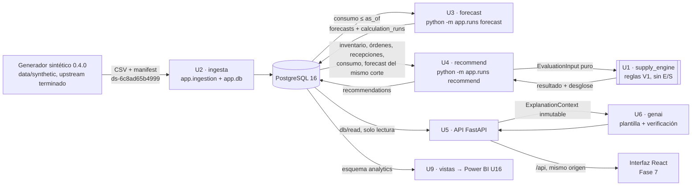

# Guía maestra del proyecto

> **Punto de entrada técnico y operativo para cualquier sesión de trabajo**, humana o de un agente.
> Complementa a [`CLAUDE.md`](../CLAUDE.md), que fija las reglas, y a [`AGENTS.md`](../AGENTS.md), que fija el
> protocolo de sesión.
>
> - **No sustituye** a los documentos autoritativos: resume y enlaza. Ante una duda, gana el documento enlazado.
> - **No copia el estado vivo:** el estado vigente está en [`project/status.md`](../project/status.md) y el de U12 en
>   [`docs/reports/u12-cierre-evidencias.md`](reports/u12-cierre-evidencias.md).
>
> Creada el 2026-10-10 sobre `main` en `5460fd9`. Si el repositorio ha avanzado, verifica lo que dice aquí antes de
> confiar en ello (§H).

### Documentos de producto

| Documento | Responde a | Cuándo consultarlo |
|---|---|---|
| [`docs/00a-prd.md`](00a-prd.md) | **Qué producto** se construye, para quién, con qué capacidades y restricciones; estado de cada requisito oficial (`RF`, `RNF`, `RS`, `RML`) y su trazabilidad | Antes de proponer o interpretar una funcionalidad |
| [`docs/00b-mvp.md`](00b-mvp.md) | **Hasta dónde llega** la primera versión (`DT-094` punto 10), qué queda fuera y **cómo se acepta** (MVP-01…MVP-10) | Antes de decidir si algo entra en la versión actual, o al registrar una prueba de aceptación |

El propietario aprobó ambos el **2026-10-14** (MVP-10); sus límites vigentes están en `docs/00b-mvp.md` §1 y §4.

## Índice

| § | Contenido |
|---|---|
| [0](#0-jerarquía-de-fuentes-de-verdad) | Jerarquía de fuentes de verdad |
| [A](#a-identidad-y-objetivo-del-sistema) | Identidad, objetivo, alcance y flujo real entre unidades |
| [B](#b-inventario-de-componentes) | Inventario de componentes (U1–U12, Fase 5, generador, interfaz) |
| [C](#c-arquitectura-y-decisiones-vigentes) | Arquitectura y decisiones vigentes |
| [D](#d-entorno-de-desarrollo-y-versiones) | Entorno, versiones, variables, comandos y errores conocidos |
| [E](#e-mapa-de-navegación-documental) | Mapa de navegación documental |
| [F](#f-operación-segura) | Operación segura (Azure y bases de datos) |
| [G](#g-estado-actual-evidencias-y-pendientes) | Estado, evidencias y cómo registrarlas |
| [H](#h-contradicciones-detectadas) | Contradicciones detectadas entre documentos |
| [I](#i-regla-de-mantenimiento-para-futuras-sesiones) | Regla de mantenimiento para futuras sesiones |

---

## 0. Jerarquía de fuentes de verdad

Cuando dos fuentes no coinciden, se aplica este orden de autoridad. La contradicción se **registra** en §H (o en
`project/status.md`, *Problemas conocidos*) y no se resuelve en silencio.

| Nivel | Fuente | Define |
|---|---|---|
| 0 | `CLAUDE.md` e instrucciones explícitas del responsable en la sesión | Reglas de trabajo. Una instrucción del responsable puede levantar una restricción solo para lo que nombra |
| 1 | Decisiones `ACEPTADA` de [`docs/15-decisiones-tecnicas.md`](15-decisiones-tecnicas.md) y contratos de unidad (`docs/04` §9, `docs/05` §19–§20, `docs/06` §16, `docs/07` §7, `docs/08` §12, `docs/09` §14) | Comportamiento autorizado. Una DT `PROPUESTA` o `PENDIENTE` **no** autoriza nada |
| 2 | README y procedimientos (`infra/azure/**/README.md`, `frontend/README.md`, `docs/12`, `docs/13`) | Cómo construir, desplegar y probar |
| 3 | Workflows y scripts (`.github/workflows/`, `infra/azure/*.ps1`, `infra/docker/`) | Lo que realmente se automatiza. Si un README contradice al script, **manda el script** para describir lo que ocurre, y la discrepancia se registra |
| 4 | [`project/status.md`](../project/status.md) | Estado actual, evidencia y bloqueos |
| 5 | Informes de cierre ([`docs/reports/`](reports/README.md)) | Pruebas, resultados y criterios de aceptación de una unidad |

El estado **real** del repositorio (ramas, commits, archivos) prevalece sobre lo que un documento dice de él
(`AGENTS.md` §1.5). La diferencia se reporta.

---

## A. Identidad y objetivo del sistema

### A.1 Qué es

**Motor Predictivo de Abastecimiento de Inventarios.** Analiza el histórico de consumo, el inventario, los tiempos
de entrega y las órdenes de compra para **predecir la demanda por SKU** y, a partir de esa predicción, **recomendar
cuánto y cuándo pedir y a quién**. No es un chatbot ni un tablero: es un motor de decisión determinista, auditable y
reproducible (`CLAUDE.md` §1–§2, [`docs/01-requerimientos.md`](01-requerimientos.md)).

Problemas que ataca: desabasto, sobreinventario y coste logístico de comprar de forma reactiva.

### A.2 Tres capas estrictamente separadas

| Capa | Hace | No hace | Implementación actual |
|---|---|---|---|
| **A. Predicción** | Demanda futura por SKU con intervalo | Decidir compras | U3 (`app.forecasting`): baselines; oficial **MA13** (`DT-089`) |
| **B. Abastecimiento** | Convertir forecast, inventario, lead time y política en recomendaciones deterministas | Estimar demanda | U1 (`app.supply_engine`) ejecutada por U4 (`app.runs`) |
| **C. IA generativa** | Explicar cifras ya calculadas | **Calcular o alterar ninguna cifra** | U6 (`app.genai`): plantilla determinista, **sin LLM** |

Regla no negociable: Azure OpenAI nunca produce, altera ni recalcula una cifra de inventario
(`CLAUDE.md` §4, [`docs/09`](09-ia-generativa.md) §14).

### A.3 Flujo real entre unidades

El flujo **no** es `U1 → U2 → U3`. U1 es una **biblioteca pura** que no lee ni escribe datos; quien la ejecuta es U4.
El orden de construcción (`DT-047`: U1, U2, …, U6) no es el orden de los datos. Fuente: [`docs/03`](03-arquitectura.md)
§16.2–§16.4.

Lo que el flujo **no** tiene:

- `api` no importa `supply_engine` ni `forecasting`: la lectura nunca recalcula.
- `genai` no tiene conexión a la base ni puede calcular.
- La demanda latente (`demand`) **no** entra en el cálculo.
- Nada en `backend/` importa `data.synthetic`.

Reglas verificables por prueba: [`docs/03`](03-arquitectura.md) §16.4.

**Corte temporal:** forecast y recomendación usan `as_of_date` explícito. El corte de referencia es `2025-12-31`
(`DT-058`). `recommend --as-of t` consume el forecast con el **mismo** corte y no lo lanza.

### A.4 Alcance actual del MVP y lo que queda fuera

**MVP local funcional aprobado** (recorrido funcional):

- dataset sintético 0.4.0;
- ingesta;
- tres baselines y forecast persistido;
- motor V1;
- recomendaciones persistidas;
- API de solo lectura (14 endpoints);
- explicación por plantilla;
- interfaz React de solo lectura;

**Soporte del sistema, fuera de las capacidades funcionales del MVP:** U7 (Docker) proporciona el medio verificable de ejecución local de MVP-08; U8 (CI) y U9 (vistas analíticas) son soporte. El propietario aceptó esta clasificación el 2026-10-14.

**Fuera del MVP:** Entra ID y despliegue U10–U12, Azure OpenAI U13 y Azure ML U14 están implementados en `dev`. U15 (AI Search) está integrada en `main` por el PR #22, con corpus sintético; el responsable creó el servicio en nivel Free (2026-10-16) y desplegó los embeddings `text-embedding-3-small` (2026-10-17), y el 2026-10-17 cargó y verificó el índice con su identidad; el asistente documental de la API la consulta desde el 2026-10-18 (`DT-103`, verificado en `dev`). La cuenta tiene USD 100 de crédito total, se conserva el umbral de planificación de USD 50 y se evaluará primero la alternativa compatible más económica. U16 (Power BI) no está autorizada.

**Fuera del MVP o diferido** (`CLAUDE.md` §3 y §17, `DT-094`):

- compras automáticas sin aprobación humana;
- ERP, WMS, rutas, *pricing*, MRP y finanzas;
- clasificación de riesgo y urgencia (bloqueada por `BR-X03`);
- escritura en la API;
- Servicios U13–U16: Azure OpenAI y Azure ML (U13/U14) están desplegados fuera del MVP; U15 está integrada en `main` (PR #22), con Search Free cargado y verificado con la identidad del responsable, sin conexión con la API; U16 sigue sin autorización;
- `staging` y `prod`;
- modelos promovidos (F5d, G2 y G3 sin autorizar).

**Las reglas V1 (`DT-031`) y los criterios `SYNTHETIC_COVERAGE_CRITERION` (`DT-041`) no son políticas de negocio.**
Toda recomendación es provisional (`policy_set = V1_PROVISIONAL`). Todos los resultados actuales, incluidos los
experimentales de la Fase 5, se basan en datos **`SYNTHETIC`**: no son una validación con datos reales.

---

## B. Inventario de componentes

Leyenda:

- ✅ **completado**: implementado y validado con sus criterios de cierre;
- 🟢 **implementado e integrado**: en `main`, con el estado formal de revisión abierto (§H);
- 🟡 **en cierre o parcial**;
- 🧪 **experimental**: solo `SYNTHETIC`, sin promoción;
- ⬜ **pendiente o diferido**.

Comandos desde la raíz del repositorio salvo que se indique `backend/` o `frontend/`.

### B.1 Datos y núcleo (Etapa 1 y U1–U6)

| Unidad | Responsabilidad | Entradas → salidas | Depende de | Contratos y DT | Archivos principales | Ejecutar y probar | Estado y limitaciones |
|---|---|---|---|---|---|---|---|
| **Generador sintético** (Etapa 1) | Publicar el dataset sintético reproducible | `dataset_config.yaml` → `data/synthetic/output/` (CSV + `manifest.json`, `ds-6c8ad65b4999`) | PyYAML 6.0.3 | `DT-023`–`DT-042`, [`knowledge/dataset-specification.md`](../knowledge/dataset-specification.md) | `data/synthetic/{config,generator}/` | `python -m data.synthetic.generator` (requiere `pip install -r data/synthetic/requirements.txt`); pruebas: `python -m unittest discover -s data/synthetic/tests -t .` | ✅ Terminado. **Upstream congelado: no se modifica.** `output/` no se versiona |
| **U1 — motor V1** | Reglas V1 puras y deterministas: `RECOMMEND` / `NO_NEED` / `NOT_CALCULABLE` | `EvaluationInput` → resultado con desglose, `reasons`, `flags` | Solo la biblioteca estándar | [`docs/06`](06-motor-abastecimiento.md) §16, `DT-031`, `DT-045`, `DT-048`–`DT-054` | `backend/app/supply_engine/` | `cd backend && python -m unittest discover -s tests -t .` (incluye sus 146 pruebas) | ✅ `ENGINE_VERSION` `0.1.0`. Sin `σ_L`, riesgo ni urgencia |
| **U2 — PostgreSQL e ingesta** | Migraciones SQL e ingesta validada, atómica e idempotente | dataset → 12 tablas y `data_loads` | `psycopg[binary]==3.3.6` (grupo `db`) | [`docs/04`](04-modelo-datos.md) §9.1–§9.9, `DT-044`, `DT-055` | `backend/app/{db,ingestion}/`, `backend/db/migrations/0001_*.sql` | `python -m app.db migrate`; `python -m app.ingestion <dir del dataset>` (desde `backend/`, con `DATABASE_URL`). Sin base: `tests/ingestion`. Con base: suite `tests/db` | ✅ Repetición → `ALREADY_LOADED`; un dataset distinto con el mismo linaje → `INTEGRITY_CONFLICT` |
| **U3 — forecast** | `ForecastProvider` y baselines (naïve, naïve estacional 52, **MA13**); 14 semanas con intervalo nominal 0,80 | consumo ≤ `as_of` → `forecasts`, `calculation_runs`, `model_versions` | Biblioteca estándar (+ `db` en `runs`) | [`docs/05`](05-motor-predictivo.md) §19, `DT-046`, `DT-056`, `DT-057` | `backend/app/forecasting/`, `backend/app/runs/`, migración `0002` | `python -m app.runs forecast --as-of 2025-12-31` (desde `backend/`) | ✅ 95 productos y 3 990 filas al corte. Banda **nominal, no calibrada**. Desabasto sin corregir (`DT-011` abierta) |
| **U4 — recomendaciones** | Leer base y forecast, llamar a U1 y persistir con trazabilidad (`input_sha256`) | base + forecast del mismo corte → `recommendations` | `db`, `forecasting`, `supply_engine` | [`docs/06`](06-motor-abastecimiento.md) §16.13, [`docs/04`](04-modelo-datos.md) §9.11, `DT-058`–`DT-063` | `backend/app/runs/recommendation*.py`, migración `0003` | `python -m app.runs recommend --as-of 2025-12-31` | ✅ 100 evaluaciones: 50 `RECOMMEND`, 40 `NO_NEED`, 10 `NOT_CALCULABLE`. Solo cargas `SYNTHETIC` |
| **U5 — API V1** | API REST de solo lectura con autenticación y roles; `provenance`, `X-Correlation-ID` | HTTP → lecturas de `db/read` | Grupos `api` y `test` (FastAPI 0.141.1, Starlette 1.3.1, Pydantic 2.13.5, uvicorn 0.52.4, `httpx2` 2.13.1); `entra` para `dev` | [`docs/07`](07-api.md) §7.1–§7.5, `DT-064`–`DT-067` | `backend/app/api/`, `backend/app/db/read/` | `python -m app.api` (solo `APP_ENV=local`, 127.0.0.1:8000). Pruebas sin base: `python -m unittest discover -s tests/api -t tests/api` (desde `backend/`) | ✅ 14 endpoints, todos `GET`. `/health` es pública |
| **U6 — explicación** | Explicación por plantilla con verificación de cifras y degradación | `ExplanationContext` → `VERIFIED` / `DEGRADED` / `NOT_APPLICABLE` | Solo la biblioteca estándar | [`docs/09`](09-ia-generativa.md) §14.5–§14.6, `DT-068`, `DT-069` | `backend/app/genai/`, `backend/app/api/routers/explanations.py` | Pruebas en la suite por defecto (`tests/genai`) | ✅ `template/1.0.0`, sin LLM. Las 100 evaluaciones reales se explican sin `DEGRADED` |
| **Interfaz React** (Fase 7) | Vistas de solo lectura sobre la API; sin reglas de negocio | `/api` (mismo origen) → vistas | React 19.3.0, TS 5.9.3, Vite 8.3.2, MSAL 5.24.0/5.7.2 | [`docs/08`](08-frontend.md) §12, `DT-070`; Entra en `DT-099` | `frontend/` ([README](../frontend/README.md)) | `npm ci`, `npm run lint`, `npm run typecheck`, `npm run format:check`, `npm test`, `npm run build` (en `frontend/`) | ✅ Fuera: dashboard priorizado, riesgos, acciones, proveedores, administración y asistente |

### B.2 Fase 5 — Machine Learning (experimental)

| Pieza | Qué es | Dónde | Ejecutar | Estado |
|---|---|---|---|---|
| F5a | Backtesting de baselines, Nivel 1 y segmentación provisional | `ml/` | `PYTHONPATH=backend python -m ml backtest --data data/synthetic/output --out ml/out --report <md>` | 🧪 Integrada (PR #8) |
| F5b | Simulador de Nivel 2 aplicado a los baselines | `ml/simulation/` | `PYTHONPATH=backend python -m ml simulate …` | 🧪 Integrada (PR #9) |
| G1 | **Baseline oficial = MA13** (`DT-089`), métrica primaria MASE (`DT-090`), valores provisionales (`DT-091`) | [`docs/05`](05-motor-predictivo.md) §20.5 | — | `ACEPTADA`, **solo con datos `SYNTHETIC`** |
| F5c | Holt, Holt-Winters, Croston, SBA y TSB en Nivel 1 y Nivel 2 | `ml/candidates.py`, `ml/f5c/` | `PYTHONPATH=backend python -m ml candidates …` (comando exacto en el informe F5c) | 🧪 Integrada (PR #11). **SES es el candidato fuerte, no promovido** |
| F5d, G2, G3 | Modelo de producción y promoción | — | — | ⬜ **Sin autorizar.** *Holdout* sin usar; banda nominal 0,80 sin validar |

Pruebas: `PYTHONPATH=backend python -m unittest discover -s ml/tests -t .` (CI publica antes el dataset). Restricciones:

- `float` solo en `ml/` y en un proveedor de modelo (`DT-074`);
- U1 no cambia;
- **no se cambia el baseline oficial ni se promueve un modelo sin una DT explícita.**

### B.3 Infraestructura, CI, analítica, autenticación y Azure (U7–U14, `DT-094`)

| Unidad | Responsabilidad | Archivos | Comando o verificación | Estado |
|---|---|---|---|---|
| **U7 — Docker** | Sistema completo local sin credenciales: `postgres` → `dataset` → `init` (migrate, ingest, forecast, recommend) → `api` → `frontend` (nginx) | `infra/docker/*.Dockerfile`, `infra/docker-compose.yml`, `infra/docker/smoke.py`, `.dockerignore` | `docker compose -f infra/docker-compose.yml --profile app up --build -d` y `python infra/docker/smoke.py` ([`docs/12`](12-devops.md) §3.4, `DT-095`) | 🟢 Integrada (PR #13). Bases por digest; el job `docker` de CI las construye (§H, K-05) |
| **U8 — CI** | Ocho jobs sin Azure: secretos, `ml`, backend, API, integración (PostgreSQL efímero), generador, frontend, `docker` | `.github/workflows/ci.yml`, `infra/ci/` | Se ejecuta en cada PR y en cada push a `main` ([`docs/12`](12-devops.md) §4.5, `DT-096`) | 🟢 Integrada (PR #14). En verde en `main` `62f25ca` (run 38035570538) |
| **U9 — analítica** | Esquema `analytics` (13 vistas) y rol `analytics_reader` | migración `0004_analytics_views.sql` | Suite de integración ([`docs/11`](11-power-bi.md) §10, `DT-097`) | 🟢 Integrada (PR #14). Las vistas dependen de tablas operativas: una migración que las altere debe recrearlas. Sin Power BI |
| **U10 — base de Azure** | Grupo `rg-motor-predictivo-dev` (`centralus`), Key Vault, identidad OIDC de GitHub (`id-mpa-dev-github`, Reader) | `infra/azure/main.bicep`, `infra/azure/modules/`, `infra/azure/deploy-dev.ps1` | [`infra/azure/README.md`](../infra/azure/README.md), `DT-098` | ✅ Completada el 2026-10-07 |
| **U11 — Entra ID** | Registros de API y SPA, app roles `ADMIN`/`PLANNER`/`ANALYST`/`VIEWER`, MSAL (código + PKCE), validación de tokens con `APP_ENV=dev` | `backend/app/api/entra.py`, `frontend/src/`, `infra/azure/entra/`, `infra/azure/deploy-u11.ps1`, `infra/docker-compose.entra-dev.yml` | [`infra/azure/entra/README.md`](../infra/azure/entra/README.md), `DT-099` | ✅ Completada el 2026-10-07 (prueba real 5/5 en el entorno aislado `u11-entra-dev`) |
| **U12 — `dev` en Azure** | Container Apps (Consumption, `WorkloadProfiles`): frontend externo HTTPS, api interna, job de *bootstrap*; ACR Basic; PostgreSQL 16 B1ms; CD por OIDC | `infra/azure/u12/`, `infra/azure/deploy-u12.ps1`, `infra/docker/bootstrap.py`, `.github/workflows/deploy-dev.yml` | [`infra/azure/u12/README.md`](../infra/azure/u12/README.md) §5–§6, `DT-100` | 🟢 **Cerrada (2026-10-13) con verificaciones pendientes aceptadas** (§G) |
| **U13 — Azure OpenAI** | Explicación generativa tras `TextGenerator`, con plantilla de respaldo | `backend/app/genai/`, `infra/azure/u13/` | [`infra/azure/README.md`](../infra/azure/u13/README.md), `DT-101` | ✅ Desplegada y verificada en `dev` el 2026-10-14; activa en la API |
| **U14 — Azure ML** | Backtesting serverless reproducible y registro de `baseline-ma13`, sin endpoint | `ml/`, `infra/azure/u14/` | [`infra/azure/u14/README.md`](../infra/azure/u14/README.md), `DT-102` | ✅ Desplegada y verificada en `dev` el 2026-10-14; Verify 7/7 |
| U15–U16, QA, entrega | AI Search, Power BI, QA integral y entrega | — | `DT-094` | U15 implementada con corpus sintético. Servicio Free `motor-predictivo-search-dev` (2026-10-16) y embeddings `text-embedding-3-small` (2026-10-17) creados por el responsable; índice con 9 fragmentos, rol de lectura de `id-mpa-dev-runtime` y `deploy-u15.ps1 -Stage Verify` en verde con su identidad (2026-10-17). Conexión con la API pendiente (`infra/azure/u15/README.md`). El corpus empresarial sigue bajo `ASSUMPTION-008`. U16 sin autorización |

---

## C. Arquitectura y decisiones vigentes

Decisiones `ACEPTADA` que determinan cómo se construye y ejecuta el sistema. El texto completo, con su contexto y
alternativas, está en [`docs/15-decisiones-tecnicas.md`](15-decisiones-tecnicas.md).

| Tema | DT | Qué fija | Fundamento |
|---|---|---|---|
| Estructura del código y puertos locales | `DT-043` | Un proyecto `backend/`, un puerto por paquete, sin capas genéricas | [`docs/03`](03-arquitectura.md) §16 |
| Orden de construcción | `DT-047`, `DT-094` | U1–U6, después U7–U16; **cada unidad necesita su propia autorización** | [`project/roadmap.md`](../project/roadmap.md) |
| Reglas V1 del motor | `DT-031`, `DT-045`, `DT-048`–`DT-054` | Fórmulas, validación, aritmética exacta (`Decimal`) y salida | [`docs/06`](06-motor-abastecimiento.md) §16 |
| Ingesta y entorno de datos | `DT-044`, `DT-055` | PostgreSQL 16, `psycopg` opcional, migraciones SQL propias, carga todo o nada | [`docs/04`](04-modelo-datos.md) §9 |
| Forecast | `DT-046`, `DT-056`, `DT-057` | Baselines, 14 semanas desde `as_of + 1`, intervalo nominal 0,80, idempotencia | [`docs/05`](05-motor-predictivo.md) §19 |
| Recomendaciones | `DT-058`–`DT-063` | Un forecast por corte, filas inmutables, `input_sha256`, `V1_PROVISIONAL`, solo `SYNTHETIC` | [`docs/06`](06-motor-abastecimiento.md) §16.13 |
| API | `DT-064`–`DT-067` | Versiones fijadas, `APP_ENV`, roles, contrato de lectura | [`docs/07`](07-api.md) §7 |
| Explicación | `DT-068`, `DT-069` | Endpoint 14, plantilla, verificación y degradación | [`docs/09`](09-ia-generativa.md) §14.5 |
| Interfaz | `DT-070` | Stack fijado, solo lectura, proxy `/api` sin CORS | [`docs/08`](08-frontend.md) §12 |
| Fase 5 | `DT-071`–`DT-093` | Protocolo de evaluación; **MA13 oficial** (`DT-089`), MASE (`DT-090`), umbrales provisionales (`DT-091`), todo `SYNTHETIC` | [`docs/05`](05-motor-predictivo.md) §20 |
| Contenedores y CI | `DT-095`, `DT-096` | Imágenes por digest, usuario sin privilegios, CI sin Azure ni credenciales, Bicep 0.48.1 fijado | [`docs/12`](12-devops.md) §3.4 y §4.5 |
| Analítica | `DT-097` | Esquema `analytics` y rol de solo lectura | [`docs/11`](11-power-bi.md) §10 |
| Azure `dev` | `DT-098`–`DT-102` | Base Bicep y OIDC; Entra ID; Container Apps, ACR, PostgreSQL B1ms, Key Vault opción C; Azure OpenAI y Azure ML ya desplegados en `dev` | READMEs de `infra/azure/` |

Decisiones abiertas que **no** deben tomarse sin el responsable:

- `DT-011`, el tratamiento del desabasto en el forecast;
- `BR-X03`, la clasificación de riesgo y urgencia;
- `DT-P02` y siguientes, en «Decisiones deliberadamente NO tomadas» de `docs/15`;
- los parámetros de negocio de [`knowledge/business-rules.md`](../knowledge/business-rules.md) §3;
- los supuestos de [`knowledge/assumptions.md`](../knowledge/assumptions.md).

---

## D. Entorno de desarrollo y versiones

### D.1 Versiones

Contrastadas con `ci.yml`, `backend/pyproject.toml`, `frontend/package.json` y los Dockerfiles.

| Herramienta | Versión que admite el proyecto | Dónde se fija | Notas |
|---|---|---|---|
| Python | ≥ 3.11; **CI 3.11.16**; imágenes 3.11.17 | `pyproject.toml`, `ci.yml`, `infra/docker/*.Dockerfile` | En Claude Code Cloud hay 3.13. Las suites pasan, pero no es la versión de referencia |
| Node / npm | **Node ^24.15.0 (CI 24.21.0)**, **npm 11.19.0** | `frontend/package.json` (`engines`, `packageManager`), `ci.yml` | Con Node 22 `engines` no se cumple |
| PostgreSQL | **16** (local `postgres:16.15-alpine3.24` por digest; Azure Flexible Server 16) | `infra/docker-compose.yml`, `DT-055`, `DT-100` | — |
| Docker | Docker con **Compose v2** | [`docs/12`](12-devops.md) §3.4 | — |
| Bicep CLI | **0.48.1**, SHA-256 `b09ec25a9d376c1f8e33ede6ed22b587f915ad68488d5db77a6f9541748c7f6e` | `ci.yml` (`BICEP_VERSION`, `BICEP_SHA256`) | 0.46.1 y 0.47.16 dan `BCP081` con `managedEnvironments@2026-07-01` |
| PowerShell | Windows PowerShell 5.1 **o** PowerShell 7 | cabecera de `deploy-u12.ps1` (solo ASCII, compatible con 5.1) | Las pruebas de `infra/tests` usan `pwsh` (verificadas con 7.4.6) |
| Azure CLI | La del equipo del responsable, con `az login` en el tenant del proyecto | `deploy-*.ps1` | Las pruebas usan un Azure CLI falso (`infra/tests/fake_az*.py`) |
| Dependencias Python | Fijadas en `backend/pyproject.toml` (grupos `db`, `api`, `test`, `entra`) y `data/synthetic/requirements.txt` | — | `python infra/ci/backend_requirements.py db api test entra` imprime la lista que usa CI |
| Dependencias JS | `frontend/package-lock.json`, `save-exact` | `frontend/.npmrc` | No editar el *lockfile* a mano |

### D.2 Variables de entorno (solo nombres; nunca valores secretos)

| Variable | Quién la lee | Obligatoria | Notas |
|---|---|---|---|
| `APP_ENV` | API | **Sí** | `local` (identidades de desarrollo) o `dev` (Entra ID); `staging` y `prod` se niegan a arrancar |
| `DATABASE_URL` | API, `app.db`, `app.ingestion`, `app.runs`, *bootstrap* | **Sí** para lo que toca la base | En Azure, **sin contraseña** (la contraseña llega como `PGPASSWORD`) |
| `PGPASSWORD` | libpq (Azure) | Solo en Azure | Secreto de Container Apps copiado del Key Vault; nunca en el repositorio |
| `DEV_AUTH_IDENTITIES` | API | Solo con `APP_ENV=local` | Tokens `dev-…` ficticios de [`.env.example`](../.env.example). Prohibida con `APP_ENV=dev` |
| `ENTRA_TENANT_ID`, `ENTRA_API_CLIENT_ID`, `ENTRA_SPA_CLIENT_ID` | API | Solo con `APP_ENV=dev` | Identificadores, no secretos (`tmp/u11-evidence/entra-dev.env`, no versionado) |
| `VITE_APP_ENV`, `VITE_ENTRA_TENANT_ID`, `VITE_ENTRA_SPA_CLIENT_ID`, `VITE_ENTRA_API_SCOPE` | build del frontend | Solo para el modo `dev` | Se pasan como `--build-arg` (`deploy-dev.yml`) |
| `API_UPSTREAM` | nginx (frontend) | No (por defecto `http://api:8000`) | En Azure, el FQDN interno HTTPS de la api |
| `LOG_LEVEL` | API | No | `DEBUG` / `INFO` / `WARNING` / `ERROR` |
| `APP_DB_USER`, `APP_DB_PASSWORD`, `RUN_AS_OF`, `DATASET_GENERATED_AT`, `BOOTSTRAP_ROOT` | `infra/docker/bootstrap.py` | Las cuatro primeras, sí (en el job de Azure) | `APP_DB_PASSWORD` es un secreto; `RUN_AS_OF=2025-12-31` |
| `U2_TEST_ADMIN_DSN` | `backend/tests/db` | Solo para la suite de integración | DSN con permiso de `CREATE DATABASE` |
| `SMOKE_FRONTEND_URL`, `SMOKE_API_URL`, `SMOKE_TIMEOUT`, `SMOKE_TOKEN`, `SMOKE_ENTRA_ENV`, `SMOKE_MODE` | `infra/docker/smoke.py` | No | Contra Azure: `SMOKE_API_URL=none` |
| `vars.*` del entorno `dev` de GitHub (`AZURE_CLIENT_ID`, `AZURE_TENANT_ID`, `AZURE_SUBSCRIPTION_ID`, `ACR_NAME`, `ACR_LOGIN_SERVER`, `AZURE_RESOURCE_GROUP`, `CA_API`, `CA_FRONTEND`, `CAJ_BOOTSTRAP`, `ENTRA_*`) | `deploy-dev.yml` | Sí, para *Deploy dev* | **Variables, no secretos**: OIDC sin `AZURE_CLIENT_SECRET` |

### D.3 Comandos por componente

| Qué | Comando |
|---|---|
| Dataset | `pip install -r data/synthetic/requirements.txt && python -m data.synthetic.generator` |
| Dependencias del backend | `cd backend && pip install -e ".[db,api,entra,test]"` |
| Suite por defecto (sin base) | `cd backend && python -m unittest discover -s tests -t .` |
| API sin base | `cd backend && python -m unittest discover -s tests/api -t tests/api` |
| Integración (PostgreSQL real) | `cd backend && U2_TEST_ADMIN_DSN=postgresql://postgres@127.0.0.1:5432/postgres python -m unittest discover -s tests/db -t tests/db` |
| Generador | `python -m unittest discover -s data/synthetic/tests -t .` |
| ML | `PYTHONPATH=backend python -m unittest discover -s ml/tests -t .` |
| Frontend | `cd frontend && npm ci && npm run lint && npm run typecheck && npm run format:check && npm test && npm run build` |
| Infraestructura (Bicep, PowerShell, contenedores, secretos) | `python -m unittest discover -s infra/tests -t infra/tests`. Sin `bicep` ni `pwsh` en el `PATH`, 26 pruebas se **omiten**: eso no es un aprobado |
| Detector de secretos | `python infra/ci/secret_scan.py` |
| Autoprueba del script de U12 | `pwsh -File infra/azure/deploy-u12.ps1 -SelfTest` (sin Azure; también la ejecuta `infra/tests`) |
| Sistema completo local | `docker compose -f infra/docker-compose.yml --profile app up --build -d`, después `python infra/docker/smoke.py` |
| Parar | `docker compose -f infra/docker-compose.yml --profile app down` (con `-v` borra la base y el dataset locales) |
| Modo `dev` local con Entra ID | [`docs/12`](12-devops.md) §3.4 (proyecto aislado `u11-entra-dev`) |

### D.4 Claude Code Cloud frente al equipo Windows del responsable

| Aspecto | Claude Code Cloud (contenedor Linux efímero) | Equipo del responsable (Windows) |
|---|---|---|
| Azure | **Sin Azure CLI, sin credenciales y con la salida a `*.azurecontainerapps.io` bloqueada por la política de red** (comprobado el 2026-10-10). No puede ejecutar ninguna etapa de `deploy-u12.ps1` contra Azure ni el smoke contra la URL real | `az login` con su sesión; ejecuta `deploy-u1x.ps1` |
| Navegador | Sin sesión interactiva de Entra ID | E2E real |
| Docker | Cliente sin *daemon*: no hay Compose ni smoke local. Los cubre el job `docker` de CI | Docker Desktop |
| PostgreSQL | Binarios de PostgreSQL 16 disponibles: se levanta un servidor efímero con `initdb` y `pg_ctl` como usuario `postgres`, en un puerto alto | Contenedor de `infra/docker-compose.yml` |
| Herramientas | Python 3.13 y Node 22 de serie. Bicep 0.48.1, `pwsh` 7.4.6 y Node 24.21.0 se descargan al directorio temporal de la sesión **verificando su SHA-256** | Instaladas |
| GitHub | Herramientas MCP de GitHub (CI, PR). *Push* solo a la rama de la sesión | `gh` y navegador |

### D.5 Errores conocidos y soluciones verificadas

| Síntoma | Causa | Solución verificada | Referencia |
|---|---|---|---|
| `BCP081` en `test_bicep_builds_and_lints_clean` | Bicep del runner (0.46.1 o 0.47.16) sin los tipos de `managedEnvironments@2026-07-01` | Bicep 0.48.1 fijado con SHA-256 en `ci.yml` | `DT-100`, notas del 2026-10-09 y 2026-10-10 |
| `ExpressEnvironmentResourceNotSupported` / `…FeatureNotSupported` en `-Stage Apps` | Entorno creado en modo Express | `environmentMode: 'WorkloadProfiles'`; `cae-mpa-dev` se convirtió en el mismo recurso con `-Stage Core` | README de U12 §5.2 |
| `firewall-rule list`: «unrecognized arguments» | `--name <servidor>` en lugar de `--server-name` | `--server-name` para el servidor y `--name` para la regla en `delete`; **`--rule-name` no existe** | `dd2d45f` y su prueba de regresión |
| `AADSTS700213` en `azure/login` | Sujeto OIDC con nombres en lugar de ids inmutables | Sujeto `repo:<owner>@<id>/<repo>@<id>:environment:dev` | `status.md`, 2026-10-09 |
| *what-if* `Unsupported` en asignaciones del ACR | `guid()` con `principalId`, que solo se conoce al desplegar | `guid(<recurso>.id, <identidad>.id, rol)` | `status.md`, 2026-10-08 |
| `INTEGRITY_CONFLICT` al repetir el *bootstrap* | `generated_at` distinto en cada generación | `DATASET_GENERATED_AT = 2026-09-29T22:54:38Z` en `bootstrap.py` | `DT-100` punto 2 |
| `AADSTS50011` en local | Origen no registrado (`127.0.0.1`) | Abrir `http://localhost:8080` | Entra README, *Problemas frecuentes* |
| `az containerapp job logs show` vacío | Sin Log Analytics (decisión de coste) | Portal → el job → *Execution history* → *Console logs* | README de U12 §10 |
| `initdb` falla como `root` | PostgreSQL no se ejecuta como superusuario del sistema | `su postgres -c "initdb …"` | — |

---

## E. Mapa de navegación documental

Todas las rutas son relativas a este archivo y apuntan a secciones existentes el 2026-10-10.

| Tema | Dónde |
|---|---|
| Reglas del proyecto y restricciones vigentes | [`CLAUDE.md`](../CLAUDE.md) §6–§17 |
| Protocolo de sesión y de reporte | [`AGENTS.md`](../AGENTS.md) §1–§9 |
| Producto (PRD) y MVP | [`docs/00a-prd.md`](00a-prd.md) §5–§7 y §12; [`docs/00b-mvp.md`](00b-mvp.md) §1, §4 y §6 |
| Requisitos (normativos, IDs oficiales) | [`docs/01-requerimientos.md`](01-requerimientos.md) §1–§5 |
| Arquitectura de implementación y reglas de dependencia | [`docs/03-arquitectura.md`](03-arquitectura.md) §16 |
| **U1** (contrato del motor) | [`docs/06-motor-abastecimiento.md`](06-motor-abastecimiento.md) §16.1–§16.12 |
| **U2** (ingesta y modelo físico) | [`docs/04-modelo-datos.md`](04-modelo-datos.md) §9.1–§9.9 |
| **U3** (`ForecastProvider` y baselines) | [`docs/05-motor-predictivo.md`](05-motor-predictivo.md) §19; criterios en §19.9 |
| **U4** (recomendaciones) | [`docs/06-motor-abastecimiento.md`](06-motor-abastecimiento.md) §16.13; [`docs/04-modelo-datos.md`](04-modelo-datos.md) §9.11 |
| **U5** (API V1) | [`docs/07-api.md`](07-api.md) §7.2 (endpoints y roles), §7.4 y §7.5 |
| **U6** (explicación) | [`docs/09-ia-generativa.md`](09-ia-generativa.md) §14.5 y §14.6 |
| Generador sintético | [`knowledge/dataset-specification.md`](../knowledge/dataset-specification.md); `DT-023`–`DT-042`; [`docs/decisions/`](decisions/) |
| Entrenamiento y evaluación de modelos | [`docs/05-motor-predictivo.md`](05-motor-predictivo.md) §20; informes F5a–F5c en [`docs/reports/`](reports/README.md) |
| Interfaz | [`docs/08-frontend.md`](08-frontend.md) §12; [`frontend/README.md`](../frontend/README.md) |
| Docker | [`docs/12-devops.md`](12-devops.md) §3.4; `DT-095` |
| CI | [`docs/12-devops.md`](12-devops.md) §4.5; `.github/workflows/ci.yml`; `DT-096` |
| Despliegue de `dev` | [`infra/azure/u12/README.md`](../infra/azure/u12/README.md) §5; `.github/workflows/deploy-dev.yml` |
| Entra ID | [`infra/azure/entra/README.md`](../infra/azure/entra/README.md); `DT-099`; [`docs/10-seguridad.md`](10-seguridad.md) §2 |
| Base de Azure (U10) | [`infra/azure/README.md`](../infra/azure/README.md); `DT-098` |
| Seguridad y secretos | [`docs/10-seguridad.md`](10-seguridad.md) §5, §6 y §15 |
| Analítica y Power BI | [`docs/11-power-bi.md`](11-power-bi.md) §10 |
| Pruebas por unidad | [`docs/13-testing.md`](13-testing.md) §14 |
| Pruebas de aceptación de U12 | [`infra/azure/u12/README.md`](../infra/azure/u12/README.md) §6; matriz C01–C15 en [`docs/reports/u12-cierre-evidencias.md`](reports/u12-cierre-evidencias.md) |
| Decisiones técnicas | [`docs/15-decisiones-tecnicas.md`](15-decisiones-tecnicas.md) (índice por `## DT-NNN`) |
| Roadmap y orden de unidades | [`project/roadmap.md`](../project/roadmap.md) |
| Estado, historial y próximos pasos | [`project/status.md`](../project/status.md) |
| Supuestos, reglas de negocio, glosario y fuentes | [`knowledge/`](../knowledge/) |
| Mantenimiento y operación | [`docs/14-mantenimiento.md`](14-mantenimiento.md) |

---

## F. Operación segura

Todas las operaciones sobre Azure las ejecuta **el responsable con su sesión**. El agente nunca recibe credenciales
(`CLAUDE.md` §17).

### F.1 Solo lectura

- `deploy-u12.ps1 -PreflightOnly` (o `-Stage Preflight`). Cada `az` pasa por la lista blanca `Test-ReadOnlyAz` y no
  se escribe nada, ni en Azure ni en disco. No se combina con otra etapa.
- `deploy-u12.ps1 -Stage Verify`. Solo lee de Azure y hace `GET` HTTP; escribe evidencias (identificadores) en
  `tmp/u12-evidence/`, que no se versiona.
- `deploy-u12.ps1 -SelfTest`, `deploy-u11.ps1 -SelfTest` y `-PreflightOnly`.
- `az … show` / `list`, `az deployment group what-if`.
- `python infra/docker/smoke.py --entra` contra la URL real.

### F.2 Modifican recursos

| Operación | Qué cambia | Confirmación que pide |
|---|---|---|
| `-Stage KeyVaultRole` | Rol personalizado mínimo y su asignación al responsable | `CREAR-ROL`, `ASIGNAR-ROL` |
| `-Stage KeyVault` | U10: `enabledForTemplateDeployment` y `networkAcls.bypass` | *what-if* restringido + `CAMBIAR-KV` |
| `-Stage Secrets` | Crea los dos secretos de PostgreSQL **solo si faltan** | — |
| `-Stage Core` | ACR, PostgreSQL, entorno, identidad de ejecución y roles | *what-if* verificado + `DESPLEGAR` |
| `-Stage Apps -ImageTag <sha>` | api, frontend y job con esa etiqueta; después `Firewall` | *what-if* + `DESPLEGAR` |
| `-Stage Firewall` | Si las IP de salida cambiaron, vuelve a desplegar `u12-dev` (con la etiqueta viva) y borra las reglas `aca-out-*` obsoletas | *what-if* + `FIREWALL` (solo si hay cambios) |
| `-Stage Bootstrap` | Ejecuta el job: escribe en la base, de forma idempotente | — |
| `-Stage Stop` / `-Stage Start` | Detiene o arranca PostgreSQL | — |
| `deploy-u11.ps1` (y `-AssignRole` / `-RemoveRole`) | Registros y asignaciones de rol de Entra ID | la de U11 |
| *Deploy dev* (`workflow_dispatch`) | Publica imágenes y crea revisiones nuevas de las apps y del job; opcionalmente ejecuta el *bootstrap* | Manual en GitHub |
| Desmontaje (README de U12 §8) | **Borra recursos y la base de `dev`** | Solo con autorización explícita |

`-Yes` salta las confirmaciones. **No** debe usarse en etapas que modifican recursos salvo que el responsable lo
decida para esa ejecución.

### F.3 Cómo validar un *what-if* y cuándo detenerse

El script ya lo comprueba (`WHAT-IF NO AUTORIZADO` → salida 2). Además, el responsable lee la lista y **se detiene**
si aparece cualquiera de estos casos:

- un `Delete`;
- un tipo de recurso fuera de U12;
- un cambio de SKU o de región;
- en la etapa `KeyVault`, cualquier propiedad distinta de las dos autorizadas o `publicNetworkAccess` distinto de
  `Disabled`;
- un cambio que no esperaba.

Los `Modify` sobre asignaciones de rol con `reference()` sin evaluar son ruido conocido (`status.md`, 2026-10-08).
**Ante la duda, no se escribe la palabra de confirmación.**

### F.4 Pruebas que detienen PostgreSQL o alteran recursos de `dev`

Pruebas de fallo de README §6:

1. Anotar antes el estado de referencia: `-Stage Verify` 20/20 (19 antes de `9d9c040`) y la etiqueta viva de la api.
2. **PostgreSQL detenido:** `-Stage Stop`. Comprobar que el frontend carga y que las vistas con datos reciben 5xx sin
   traza ni secreto.
3. **Recuperación:** `-Stage Start`, esperar a `Ready`. Si la API no conecta, `-Stage Firewall`. Después
   `-Stage Verify` debe volver a dar 20/20.
4. **Imagen inexistente:** `-Stage Apps -ImageTag 0000000` (formato de SHA válido que no existe en ACR; `noexiste` lo
   rechaza el script antes de desplegar). La revisión nueva no arranca y la anterior sigue
   sirviendo. Restaurar con `-Stage Apps -ImageTag <sha bueno>` y verificar.
5. **Token inválido:** `curl` a `/api/...` a través del frontend con `Authorization: Bearer x` → 401. Es de solo
   lectura.

Ninguna prueba borra datos. Si una recuperación no devuelve el estado de referencia, **parar** y registrar el
bloqueo antes de hacer nada más.

### F.5 Costes y reanudación

| Recurso | Coste | Pausa | Reanudación |
|---|---|---|---|
| PostgreSQL B1ms | Cómputo por hora mientras está arrancado; almacenamiento siempre | `-Stage Stop`. **Azure lo vuelve a arrancar solo a los 7 días** | `-Stage Start`, esperar a `Ready`; si la API falla al conectar, `-Stage Firewall`; después `-Stage Verify` |
| ACR Basic | ≈ 5 USD/mes; cada redespliegue añade imágenes | — | Borrar etiquetas antiguas si se acercan los 10 GB |
| Container Apps | Escala a cero; dentro de la concesión gratuita en uso de demo | Automática | La primera petición tarda (arranque en frío) |

Estimaciones, no cifras garantizadas: README de U12 §7.

### F.6 Prohibido sin autorización explícita del responsable

- Desplegar o borrar recursos fuera de las etapas documentadas.
- Ejecutar el desmontaje.
- Cambiar U10 o el Key Vault fuera de la etapa `KeyVault`.
- Usar `0.0.0.0` en el firewall.
- Crear o rotar credenciales, o leer secretos.
- Cambiar la configuración de `main` o hacer *merge*.
- *Push* fuera de la rama de trabajo.
- Ampliar U12 (`staging` o `prod`), iniciar unidades sin autorización (actualmente U16) o pasar U15 a un nivel con cargo continuo (Basic o superior) sin autorizar su gasto.
- Modificar el generador o el dataset 0.4.0.
- Promover un modelo o cambiar el baseline oficial MA13.
- Tomar decisiones de negocio.

---

## G. Estado actual, evidencias y pendientes

### G.1 U12

**Fuente única del estado:** [`docs/reports/u12-cierre-evidencias.md`](reports/u12-cierre-evidencias.md), con la
matriz C01–C15 y el origen de cada evidencia. Esta sección solo resume; si difiere del informe, manda el informe.

**Estado:** U12 **cerrada el 2026-10-13 con verificaciones pendientes aceptadas por el responsable** (informe,
revisión 7). Matriz: 12 `APROBADO` (C01–C11, C15) y 3 `PARCIAL` con pendientes aceptados (C12–C14).

**Demostrado en Azure**, con evidencia aportada por el responsable desde su PowerShell y su navegador. **No** la
ejecutó un agente y no está versionada:

- despliegue `u12-dev` `Succeeded`; api y frontend `Running`; entorno `WorkloadProfiles`;
- *bootstrap* `tbazfuc` con `BOOTSTRAP OK` (100 recomendaciones: 50/40/10);
- `Verify` 20/20 (19/19 antes de `9d9c040`), «U12: dev verificado»; `SMOKE OK (entra-dev)`;
- inicio de sesión real y matriz de los cuatro roles y sin rol; sin token → 401;
- `-Stage Firewall` completo y recreación de una regla borrada;
- redespliegue con `fd50c6b` y *bootstrap* `lshnjjx` `Succeeded`;
- fallos: job sin base `Failed` y recuperación sin duplicados; PostgreSQL detenido (frontend 200, API 503) y
  recuperación; `Bearer x` → 401.

**Estas salidas no deben volver a pedirse.**

**Verificaciones pendientes aceptadas** (informe §4, P1–P5): revisión de las vistas en el navegador, idempotencia
detallada del redespliegue, paso de parada del job fallido, imagen inexistente con SHA válido y el efecto de la regla
borrada. No bloquean; si alguna falla al ejecutarse, se abre una incidencia sobre `dev`.

### G.2 Cómo registrar una prueba

1. **Etiquetar el origen** de cada resultado:
   - **[AZ-U]**: ejecutado en Azure por el responsable;
   - **[AZ-A]**: ejecutado en Azure por un agente con acceso autorizado;
   - **[CC]**: ejecutado en Claude Code Cloud (local o entorno sustituto);
   - **[CI]**: GitHub Actions, con el número de run;
   - **[PEND]**: no ejecutado.
2. Un resultado solo es **APROBADO** si hay una salida real que cumple las condiciones de aceptación del criterio.
   Una prueba local o en un entorno sustituto (p. ej. `bootstrap.py` contra PostgreSQL efímero) **no** aprueba un
   criterio de Azure: como mucho lo deja **PARCIAL**.
3. Copiar solo **identificadores y resultados literales**: nunca tokens, contraseñas, cadenas de conexión ni cabeceras
   `Authorization`.
4. Actualizar, en el mismo cambio:
   - la fila del criterio en el informe de cierre;
   - una fila en el historial de [`project/status.md`](../project/status.md);
   - la nota de la DT si cambia el estado de la unidad;
   - la fila de [`project/roadmap.md`](../project/roadmap.md) cuando la unidad se cierre.
5. Si una prueba falla o se bloquea, registrar el error literal y el bloqueo; **no** reintentar con mecanismos distintos
   de los del contrato.

---

## H. Contradicciones detectadas

Revisión del 2026-10-10. Ninguna se ha resuelto cambiando una decisión. Las correcciones de hechos verificables
están marcadas como tales.

| ID | Contradicción | Fuentes | Más autoritativa | Resolución |
|---|---|---|---|---|
| K-01 | `README.md` (2026-09-30) dice que el sistema no está implementado y que `backend/`, `frontend/`, `ml/`, `infra/` y `.github/workflows/` no existen | `README.md` frente al repositorio y a `status.md` | Repositorio (`AGENTS.md` §1.5) | **Hecho corregido:** aviso al principio de `README.md` que remite a esta guía y a `status.md`. **Resuelto (2026-10-13):** `README.md` reescrito con el estado real, la demo local, la tabla de tecnologías y las pruebas; los documentos `docs/03`–`docs/14` llevan una línea de estado vigente |
| K-02 | `CLAUDE.md` §14: «`ml/` y `.github/workflows/` aún no existen» | `CLAUDE.md` frente al repositorio | Repositorio | **Hecho corregido** en `CLAUDE.md` §14 |
| K-03 | `AGENTS.md` §9 y §10 exigen preguntar antes de cualquier commit; `CLAUDE.md` §13 (2026-10-06) permite al agente commits en ramas de trabajo y reserva *push*, PR y *merge* al responsable; en la sesión del 2026-10-10 el responsable pidió expresamente *push* y PR | `AGENTS.md`, `CLAUDE.md`, instrucción de sesión | `CLAUDE.md` (fuente operativa y posterior) más la instrucción explícita de la sesión | **Sin cambio de regla:** se registra. El responsable decide si alinea `AGENTS.md` |
| K-04 | U7, U8 y U9 figuran «pendiente de revisión» (`roadmap.md`, `status.md` §Progreso, `docs/12` §3.4 y §4.5, `docs/11` §10), pero están integradas en `main` (PR #13 y PR #14, `70e69f9`) | Documentos de estado frente a Git | Git para la integración; el **estado formal de revisión es decisión del responsable** | **Sin cambio de estado:** se registra. En §B se marcan 🟢 «implementado e integrado» |
| K-05 | U8 «falta la primera ejecución real» y U7 «digest pendiente de verificación externa», pero CI se ha ejecutado en GitHub y está en verde en `main` `62f25ca` (run 38035570538, con el job `docker` que construye con las bases por digest) | `roadmap.md`, `docs/12` §3.4 frente a GitHub Actions | GitHub Actions ([CI]) | **Hecho registrado** aquí; las etiquetas de estado las actualiza el responsable (K-04) |
| K-06 | Roadmap, fila U11: «código pendiente de commit y PR», pero está en `main` (commits `329da12`, `70e6887` y `71dd044`, PR #14) | `roadmap.md` frente a Git | Git | **Hecho registrado**; sin cambio de estado |
| K-07 | `docs/12` §5: `dev` «automático desde `main`», frente a `DT-100`: despliegue manual (`workflow_dispatch`) | `docs/12` §5 tabla frente a `DT-100` | `DT-100` (`ACEPTADA`, posterior); la propia `docs/12` §5 lo anota | Ya anotada en `docs/12`; no requiere cambio |
| K-08 | Número de comprobaciones de `Verify`: 18 (fila de `status.md` del 2026-10-08) frente a 19 (script, README y evidencia real) | `status.md` frente a `deploy-u12.ps1` | Script | La fila es historial anterior a la comprobación `WorkloadProfiles`; vale 19 hasta `9d9c040` y **20** desde entonces (rol de GitHub sobre el job) |
| K-09 | `DT-100` dice que U12 no se cierra hasta cumplir «los 15 criterios», pero ningún documento los enumera | `DT-100` | `DT-100` (exige 15), sin lista | Matriz **derivada** C01–C15, en estado `PROPUESTA` hasta su validación, en el informe de cierre |
| K-10 | El *Estado* de `DT-100` dice «nada creado todavía» | `DT-100` frente a sus notas posteriores y la evidencia real | Notas posteriores y evidencia | Texto histórico; el estado vigente está en las notas del 2026-10-10 |
| K-11 | Varios requisitos «Debe» aprobados en `docs/01` (RF-013, RF-014, RNF-012 y las escrituras de RF-001, RF-004, RF-005 y RF-008) no están en la V1, porque decisiones aceptadas los aplazan (`BR-X03`, `docs/07` §7.3, `DT-059`). Ninguna fuente enumera qué exige formalmente el MVP | `docs/01` frente a `DT-094` y los contratos de V1 | Decisiones aceptadas para la V1; `docs/01` para la necesidad | **Sin cambio:** se clasifican como *pendientes*, no se eliminan. Pregunta abierta al propietario en `docs/00b-mvp.md` §1.3 y en `docs/00a-prd.md` §12.2 |

---

## I. Regla de mantenimiento para futuras sesiones

Toda sesión que trabaje en el proyecto:

1. **Lee esta guía antes de trabajar** y después los documentos autoritativos de la unidad (§E).
2. **Consulta el PRD** ([`docs/00a-prd.md`](00a-prd.md)) para entender qué producto se construye, y **el MVP**
   ([`docs/00b-mvp.md`](00b-mvp.md)) para conocer sus límites.
3. **Interpreta un requisito concreto en las DT y los contratos** (`docs/15`, `docs/04`–`docs/09`), no en el PRD: el
   PRD resume y enlaza.
4. **Consulta el estado actual en [`project/status.md`](../project/status.md)** y verifica la evidencia en los informes
   de [`docs/reports/`](reports/README.md).
5. **No replica requisitos** en varias fuentes cuando basta un enlace. Los identificadores oficiales son los de
   `docs/01`; no se crean otros.
6. **Actualiza estado y evidencias cada vez que ejecuta una prueba** (§G.2):
   - la fila del criterio en el informe o en `docs/00b-mvp.md` §6;
   - el historial de `status.md`.
7. **No inventa** estados, decisiones aprobadas, resultados de pruebas ni requisitos. Lo que no tenga fuente se marca
   `Por definir`, `Propuesta pendiente de aprobación` o `Pendiente de evidencia`.
8. **No amplía el MVP sin aprobación explícita del propietario.** Un servicio que aparece en la arquitectura o en el
   roadmap no entra en el MVP por ese motivo (`DT-094` punto 10).
